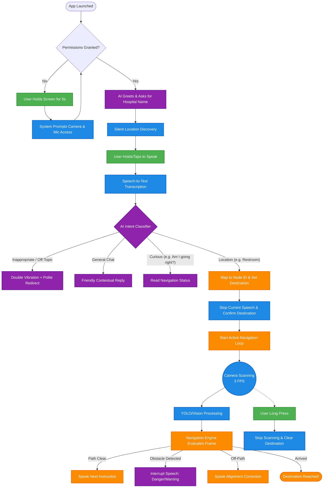

# Lumina Hospital Navigation 🏥

Lumina is an AI-powered, voice-activated hospital navigation assistant designed specifically for visually impaired users. It uses real-time camera processing, local coordinate mapping, and a Large Language Model (LLM) to guide users through complex hospital environments safely.

---

## 🧭 High-Level App Workflow

The application operates in several distinct phases to ensure the user is safely guided to their destination without overwhelming them with unnecessary audio.



---

## 🧠 System Architecture Details

### 1. The Permissions & Initialization Gate
Because the app relies heavily on audio, it will **not** start until Camera and Microphone permissions are explicitly granted. 
* If permissions are missing, the screen is black, and a voice loop instructs the user to hold the screen for 5 seconds to trigger the OS permission prompts.
* Once granted, it asks the user to name their current hospital and begins a **Silent Scan** (camera is active, but no navigation instructions are spoken yet).

### 2. Speech-to-Text & The AI Intent Filter (`/filter`)
When the user taps or holds the screen, the STT (Speech-to-Text) engine listens. The transcribed text is sent to the LLM backend along with a list of available `destinations` and the user's `contextInfo` (current location).

The AI categorizes the intent into four buckets:
* **Location:** Maps colloquial speech (e.g., "ห้องน้ำ") to an exact system ID (e.g., `GF_Restrooms`). If the LLM makes a mistake, the frontend has a fallback fuzzy-matcher.
* **Curious:** If the user asks "Am I going the right way?", the AI generates a response based on the active `contextInfo`.
* **Inappropriate / Off-Topic:** Filters out profanity and questions unrelated to navigation (e.g., "What color is the sky?"). It buzzes the phone twice and asks the user to state a destination.
* **General:** Simple greetings ("Hello", "Thank you").

### 3. The Navigation Engine (`NavigationEngine.ts`)
Once a destination is confirmed, the engine plots a path using a local node graph (`data-mock.json` / `data-simple.json`). 
* **State Updates:** It tracks if the user is `locating`, `navigating`, `lost`, or `arrived`.
* **Event Throttling:** Turn-by-turn instructions (`navigation_step`) have a 15-second cooldown so they don't spam the user.
* **Priority Interrupts:** If a `danger` or `warning` is detected (e.g., an obstacle), it immediately clears the speech queue and plays the warning.

### 4. Audio Management (`voice.ts`)
The speech system uses a robust queuing mechanism:
* When a user sets a new destination, `stopSpeech()` is called to instantly clear any lingering chatter.
* The first navigation step is immediately extracted and spoken.
* Instructions are played sequentially, ensuring no overlapping audio.

### 5. UI / UX Design
Though designed for the visually impaired, the UI provides critical debug and status information for caretakers and developers:
* **Top Bar:** Shows the current system state (e.g., "กำลังนำทาง"), the current location node 📍, and the target destination 🎯.
* **Instruction Bar:** A compact blue bar showing the current text-based instruction.
* **Performance Overlay:** Tracks FPS and latency to the backend server.
* **Big Red Cancel Button:** Holding the screen or tapping the stop button halts the camera and cancels the route.

---

## 🚀 Running the Project

1. **Start the AI & Backend Tunnels**
   Ensure your Python STT server and Node.js AI server (`lib/LLM/ai.ts`) are running.
   *(Make sure your `OPENROUTER_API_KEY` is set in `lib/LLM/.env`!)*

2. **Start the Expo App**
   ```bash
   npx expo start
   ```

3. **Simulator Mode**
   You can test the navigation graph logic without walking around physically by running the simulator script or navigating to the `/simulator` route.
